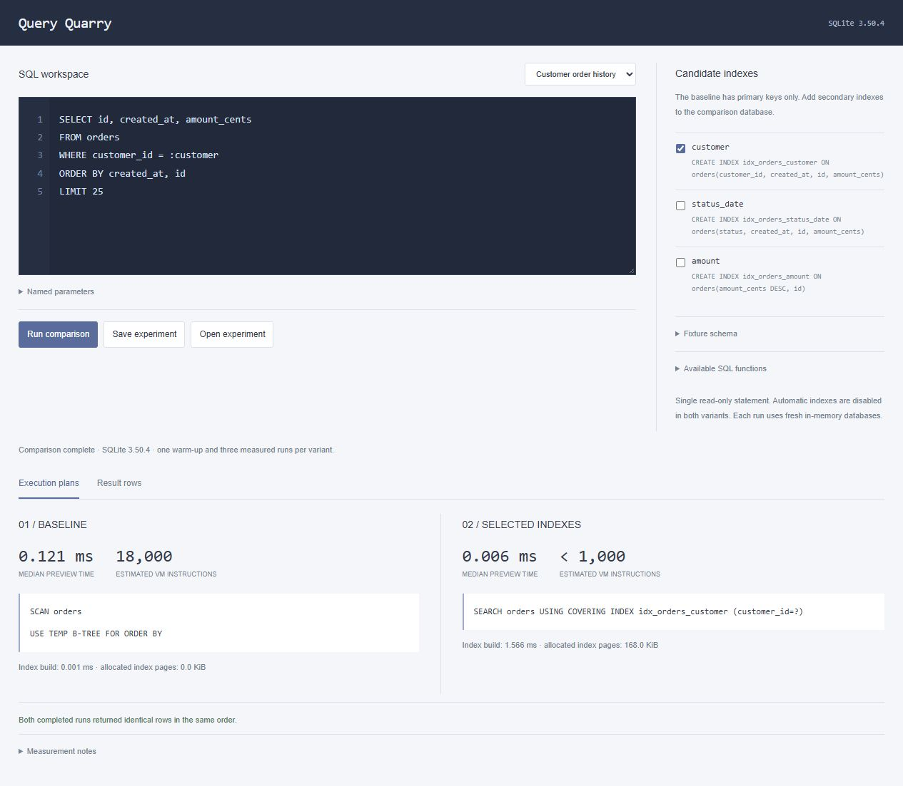

# Query Quarry

A real SQLite query-plan lab. Run the same parameterized query against identical synthetic datasets with and without selected secondary indexes; inspect plans, bounded result previews, timing samples, and estimated VM work.



## Run

```sh
python run.py
```

Requires **Python 3.11+** for SQLite connection limits. Open http://127.0.0.1:8000/. Use `--port 8834` for another port. No runtime package installation is needed.

Every experiment creates two fresh in-memory databases with 1,000 synthetic customers and 6,000 synthetic orders using a fixed seed. No user database is opened or modified. The loopback server has no external-service dependencies.

## Explore

- Start with customer history, status/date filtering, high-value orders, or a regional join/aggregation.
- The SQL editor and index selector share the main workspace. Execution plans and result rows have separate output views.
- Edit a read-only SQL statement and bind named parameters through a separate JSON object. Ctrl/Cmd+Enter runs the comparison.
- Enable a customer/date covering index, status/date covering index, or amount-ordering index. Inspect their exact DDL in the sidebar.
- Compare raw `EXPLAIN QUERY PLAN` descriptions, median preview times, estimated VM instructions, index-build time, and allocated index pages.
- Switch between both result previews, export CSV or a complete JSON experiment report, and save/reopen experiment JSON.
- Inspect schema and allowed functions without leaving the workbench.

The baseline retains SQLite integer primary keys but has no secondary indexes. Automatic indexes are disabled in both variants. `ANALYZE` is run before measurement. Indexes are built from a fixed allowlist rather than arbitrary submitted DDL.

## Measurement boundaries

Each variant performs one warm-up followed by three measured **execute-and-fetch previews**. Only the first 101 rows are fetched; 100 are displayed. The median excludes fixture construction, index creation, and statistics collection. Statement caching is disabled. The baseline runs before the indexed variant, so timings are illustrative and not a controlled benchmark of production workloads.

A progress callback runs approximately every 1,000 SQLite VM instructions. The report's `vm_steps_estimate` is the callback count multiplied by 1,000 for the last measured run; zero means no callback occurred, displayed as `< 1,000`. This is coarse instrumentation, not an exact instruction counter. Callback overhead affects timing. Very short queries are particularly sensitive to timer noise.

Each query execution is limited to 300,000 observed VM instructions or 500 ms, checked by the progress handler. String/blob size, SQL length, expression depth, column count, and compound-select count also have SQLite limits. Text results longer than 1,000 characters are visibly clipped, and blobs display as hexadecimal strings.

The comparison reports ordered preview equality and unordered multiset equality. It separately records whether both results completed without row truncation or cell clipping. Matching capped previews **do not establish full-result equality**. Without `ORDER BY`, row order can change with the plan; time-dependent functions can also produce different results between executions.

Allocated index bytes are the increase in SQLite page count times page size during index creation, before `ANALYZE`. They describe allocated database pages, not actual process memory or a filesystem file size.

## Execution boundary

SQLite's authorizer permits SELECT/read/recursive-query actions on the two fixture tables and an explicit function allowlist. A separate `query_only` setting reinforces read-only execution. Writes, schema changes, PRAGMAs, attachments, extension loading, and reads of internal schema tables are denied. Parameters are bound, never interpolated. Multiple statements are rejected by `execute`.

The browser accepts exact JavaScript integers; the Python API also accepts signed 64-bit integer parameters. Nulls, short strings, and finite numeric parameters are supported. Nonfinite query outputs are rejected. CSV cells that could begin spreadsheet formulas are prefixed with an apostrophe; null cells display as `NULL`.

This is a bounded teaching tool over a fixed fixture, not a production database profiler. It does not model disk I/O, concurrency, distributed execution, write amplification under load, or other database engines. SQLite versions and host performance affect plans and timings.

## API and files

`GET /api/catalog` returns schema, index choices, examples, allowed functions, and SQLite version. `POST /api/compare` accepts:

```json
{
  "sql": "SELECT id FROM orders WHERE customer_id = :customer ORDER BY id",
  "parameters": { "customer": 42 },
  "indexes": ["customer"]
}
```

The same structure is used for saved experiment JSON. Query execution errors are returned per variant in a completed HTTP 200 report; invalid request shapes return HTTP 400. The HTTP server restricts loopback Host/origin headers, rejects duplicate JSON fields/nonfinite JSON numbers, and exposes only three static assets. It does not persist SQL or experiment data.

`engine.py` contains fixtures, isolation, measurement, and comparison. `run.py` implements the local API. `app.js` manages the editor, request cancellation/stale-result handling, presentation, and exports. Aborting a browser request stops waiting for its response; server execution remains independently bounded.

## Verify

```sh
python -m unittest discover -s tests -v
npm run check
```

Node.js is needed only for the syntax check; no npm install is required. Twelve Python tests cover plan changes, equal results for all examples, preview caps, rejected writes/attachments/extensions/PRAGMAs, recursive-query budgets, large-string limits, parameter binding, read-only CTEs/windows, blob presentation, nonfinite outputs, request validation, and HTTP boundaries. CI runs Python 3.11/3.13 on Linux and Windows.

Browser checks cover scan-to-covering-index changes, complete result comparison, truncated previews, rejected statements, and report export.

## References

- [SQLite: EXPLAIN QUERY PLAN](https://www.sqlite.org/eqp.html)
- [Python: SQLite authorizers, progress handlers, and limits](https://docs.python.org/3/library/sqlite3.html)
